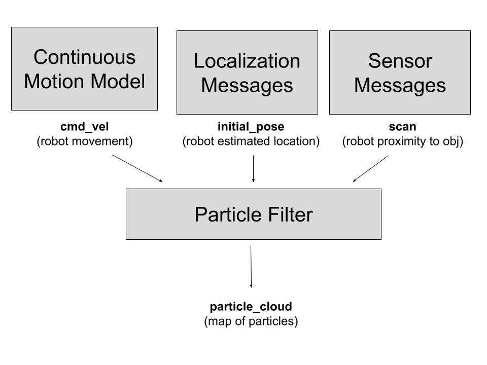

# Robot Localization
Author Names: Mik Miller and Pippin Fleet 

For Olin ENGR 3590 Computational Introduction to Robotics
## Project Overview
We investigated the process of locating a robot using a particle filter. In particular, we used a neato. Our goal was to be able to determine the neato’s position by making a lot of guesses and checking them against the position of the real neato. Unfortunately, our code is not yet ready to be run but it is close. 

## Algorithm Overview
We create a set of particles that disperses across the map and weight them based on how similar they are in terms of their laser scans. When the real neato moves each particle is moved as well according to its heading.  

- **Process Subscribers and Msgs**: The beginning of the algorithm imports msgs such as the laser scan and initial odom pose and converts them to a usable format.
- **Normalize Particles (Implemented by Mik)**: Checks if probability weights already sum to 1 and if not, scales the particle weights by an equal factor so that they do.
### Run Loop Order
- **Initialize particle cloud (Implemented by Mik)**: Creates a list of particles that are controlled with a gaussian distribution with an aspect of randomness. The specific variables that are controlled are the x position, y position, and angle of each of the particles. This function also uses self.update_robot_pose(), which is defined later and self.normalize_particles(). This function is only called if a particle cloud does not already exist.
- **Update Particles w/ odom (Implemented by Pippin)**: iterates through each particle in the particle cloud and updates its position relative to its preexisting heading.
- **Update Particles w/ laser (Implemented by Pippin)**: finds the closest obstacle and compares it to closest obstacle for the real neato. It then finds the difference between these two values and sets the weight of the particle to the inverse of that distance such that the smaller differences increase the weight of the particles.
- **Update Robot Pose (implemented by Mik)**: Uses self.normalize_particles and then calculates a best estimate of where the robot is likely to be based on the given information. This function stores the generated guess as the robot’s current pose (self.robot_pose)
- **Resample Particles (Implemented by Pippin)**: First the highest weighted particle is found and a normal distribution is created around the x and y values of this particle. Then the first 200 particles are resampled from this distribution and the other particles are sampled randomly but uniformly across the map.distribution. The remaining particles are created by sampling randomly but uniformly across the map. This strategy ensures the next particles are mostly in a likely place but are not converging in the wrong place too quickly.

### Implementation Design
We made several design choices that both specifically suited our approach and made the most sense to us. 
#### Setup and Init
The given run loop was defined before functions within it and the functions were a different order than how they were in the run loop. Even though this had initially thrown us off, we had decided against reordering the code to avoid merge conflicts, gain practice reading code written by others, and avoid destroying code before we fully understood it.
#### Normalize Particles
We implemented a mechanism that handles already normalized particles to avoid error values if this function were to be overcalled. We also implemented flexibility handling for sums that are close to 1. 
#### Initialize Particle Cloud
We used a normalized distribution to randomly sample particles rather than a true random sample. This allows us to represent noise in a controlled way while still being able to roughly tell the general particle position. At the top in the init function, we define the noise threshold of each variable as constants. Each constant is 0.1 as a starting spot, we plan to tune once our model is working.
#### Update Particles with Odom
Calculates the difference between the neato’s old pose and its new one and uses this to create a matrix that when multiplied by each particle returns a new particle that has been transformed into a position comparable to how the actual neato moved.
#### Update Particles with Laser
Takes in the x and y of each particle and uses get_closest_obstacle to find the smallest distance from it to an obstacle and then subtracts this from the minimum distance the real neato sees to an object. Then the inverse of this distance becomes the particle’s new weight.
#### Update Robot Pose
The helper docstring suggested either to compute the mean pose of the particles or compute the most likely pose of each particle. While we could have implemented our own method, we used the suggestions to keep things simple. We decided to compute most likely pose because we figured this would be easier to implement with the motion model.
#### Resample Particles
Iterates through every particle to find the one weighted the highest and creates a normal distribution around it for both its x and y. Using this distribution the first 200 particles are resampled while the remaining ones are assigned randomly but uniformly within the bounds of the map.
#### Motion Model (In Progress)
This is a separate node based off of drive square that publishes command velocities to our particle filter. We ran into a stuck point while trying to convert the input odometry measurements to input velocity commands as well as transforming these. This was not something we accounted for when scoping the project. However, we got close to completely implementing this. As a future step, we would probably spend more time to figure out this conversion.

##### Motion File
- **Drive**: publishes linear and angular velocities to a Twist msg
- **degree2radians**: converts a list of angles in degrees to radians for ease of use
- **Drive Forward**: handles forward linear motion of the robot. this is untouched from drive square because it accomplishes forward motion for our model without needing adjustment
- **Turn**: handles turns of the robot. This function uses random angles to simulate an exploratory robot. 

##### Pf File
- Implemented a referenceable subscription to receive command velocities
- Implemented a msg received and processing function to handle the incoming subscription
- (In progress) Implemented a function called update_particles_with_vel to function similarly to update_particles_with_odom. Although this function is yet to be complete, we did not comment it out since it is not yet called anywhere. 

### Unit Test Design and Integration
Pippin

The main way my code was tested was through print statements at key points in the code to determine if certain loops were actually running. 

Mik
#### test_pf
For the pf file TODOs, I used a separate file with Pytest. 

##### Create Particle Filter
- **Sample Length (Passed)**: I tested that each of the particles were being added to the sample list correctly. I wanted to make sure that if we specified a list of 300 particles, that 300 items would be returned and that the list would not include items that were not particles or would work in the first place
- **Test Cloud Values (Passed)**: I wanted to make sure that each of the values were returning as int or float numbers and not as "None" or other data types
##### Normalization
- **Test Normalization (Passed)**: I wanted to make sure that this function was implemenented correctly and that it created the expected output

##### Robot Update
- **Test Robot Update (Passed)**: I wanted to make sure that the largest weight was selected as the best guess of where the robot might be. 

#### test_motion
For the motion model TODOs, I created a fake set of variables since these functions more dependently relied on ROS2. I mainly tested if these functions returned the expected results in radians.

### Challenges and Next Steps
It was challenging to read through and understand all of the code, particularly learning which variables were which and where the various functions and helper functions were. It was also challenging to understand what the particles were, for example they had x, y, and theta but not laser scans which was somewhat confusing. We addressed challenges by reaching out for help at office hours and tutoring and additionally working together and asking each other for help. If we had more time we would like to implement a more sophisticated way for the neato to move without requiring manual inputs.

### Learning Objectives and Final Takeaways
- **Pippin**: my main goal was to get more experience reading and writing code. I feel I accomplished this by reading through and understanding the skeleton code and completing half the TODOs. I did accidently write my own algorithm instead of using one that was given which gave me more experience but is also a reflection of how I still often struggle to understand code.

- **Mik**: My main goal was to get more familiar with building packages and start setup processes early. For the most part, I think I acheived this pretty well. I had been building packages since day 1 of this assignment and cleared up confusion around this from the last project in a non rushed or stressful way. Because of this, I feel like I more solidlly understand. I still have trouble accounting for what I do not know in terms of project scoping but I feel like I am making steady progress on this. I have learned a ton about communication approaches and have been able to further pinpoint my strengths and weaknesses in this area
